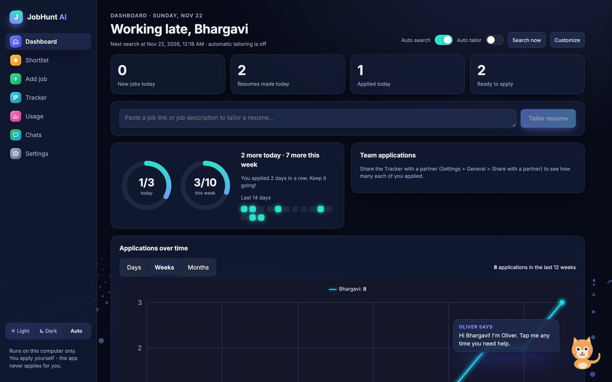
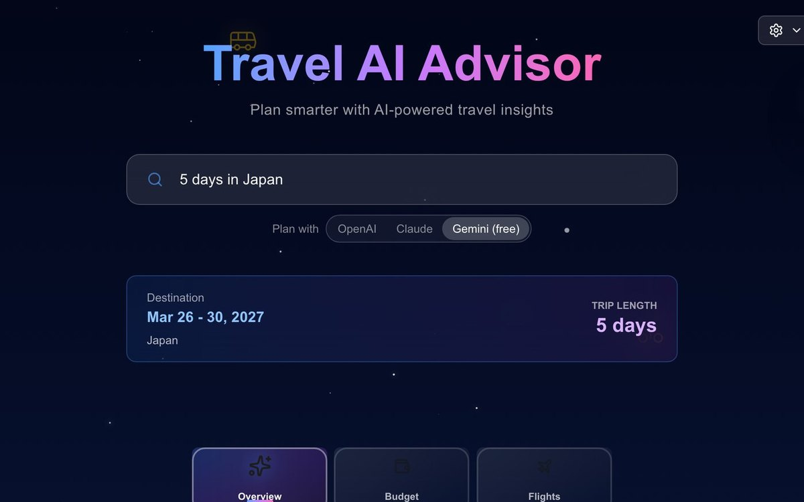
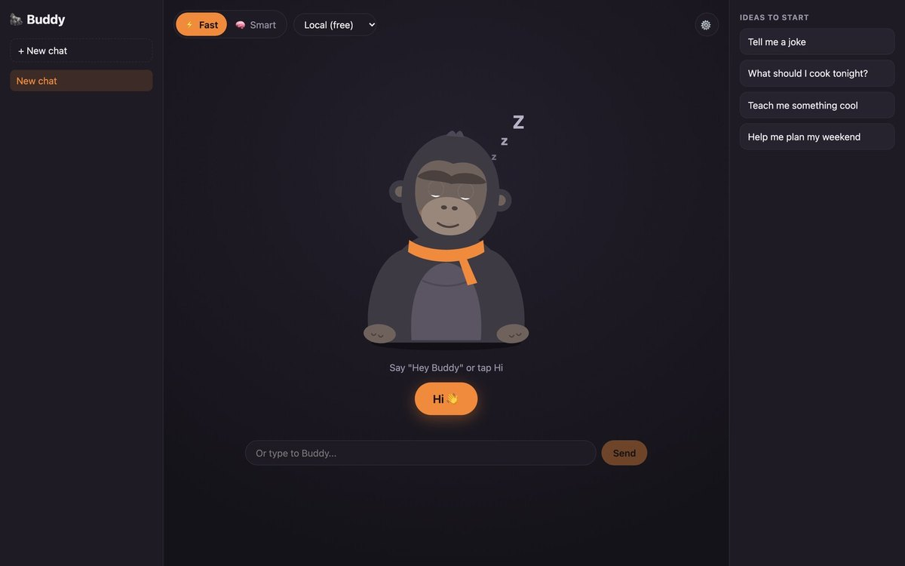
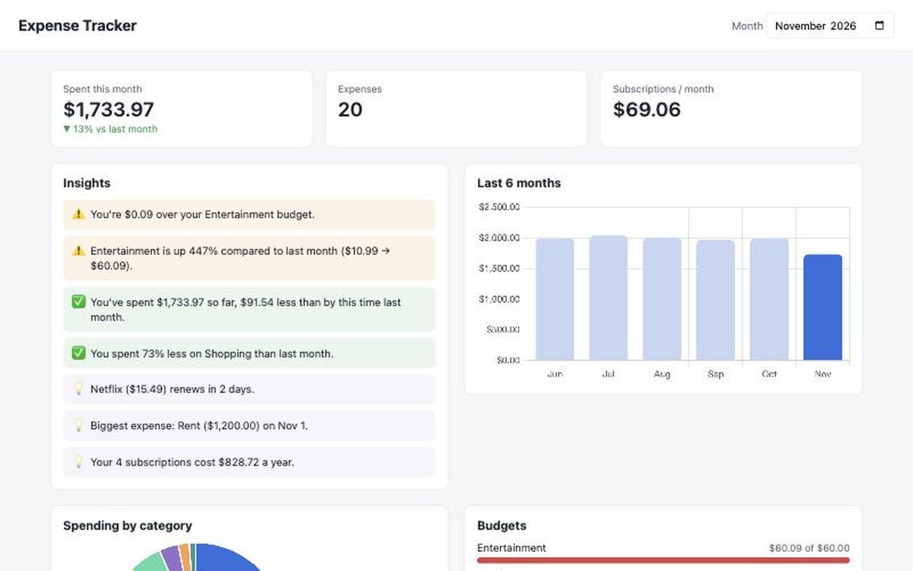

  

  
  
  

Hi, I'm Bhargavi 👋

I like building AI tools that take a boring, repetitive job off someone's plate and do it well: finding the right jobs and rewriting a resume for each one, planning a trip from one sentence, or just talking to you. I build them end to end, from the model calls and the data underneath to the screens people actually click on.

A few things I care about when I build:

- **Useful first.** Every project here started as something I needed myself.
- **Honest AI.** The model helps, code checks its work. Facts like names and dates come from the source, never from the model.
- **Cheap to run.** Free tiers, local models and subscriptions before paid APIs, with hard limits in code.
- **Private by default.** Personal details are masked before anything goes to an AI.

> **Open to work.** I'm looking for roles where I can build AI products people use every day. [Let's talk on LinkedIn](https://www.linkedin.com/in/askbhargavi/) or [email me](mailto:bhargavi2574@gmail.com).

## Things I've built

<table>
  <tr>
    <td width="50%" valign="top">
      
      <h3><a href="https://github.com/bhargavithoka-overclocked/jobhunt-ai">JobHunt AI</a></h3>
      A desktop app that finds new jobs at H-1B sponsors, ranks them, and writes a tailored resume and cover letter for each one in PDF and Word. One AI call per job, with code checking every fact against the master resume.
        
      <code>Python</code> <code>FastAPI</code> <code>React</code> <code>SQLite</code> <code>Playwright</code> <code>Claude / ChatGPT</code>
    </td>
    <td width="50%" valign="top">
      
      <h3><a href="https://github.com/bhargavithoka-overclocked/ai-trip-planner">AI Trip Planner</a></h3>
      Type where you want to go and get a full plan: best places, food, areas to stay, a budget breakdown and a day-by-day itinerary. Pick OpenAI, Claude or Gemini's free tier.
        
      <code>Next.js</code> <code>TypeScript</code> <code>Tailwind</code> <code>OpenAI</code> <code>Claude</code> <code>Gemini</code>
    </td>
  </tr>
  <tr>
    <td width="50%" valign="top">
      
      <h3><a href="https://github.com/bhargavithoka-overclocked/buddy-voice-assistant">Buddy, a voice assistant</a></h3>
      Say "Hey Buddy" and talk about anything. An animated gorilla who listens, thinks and talks back in real time, and you can interrupt him. Runs free and fully local as a Mac app.
        
      <code>FastAPI</code> <code>WebSockets</code> <code>React</code> <code>Electron</code> <code>Whisper</code> <code>Piper</code> <code>Ollama</code>
    </td>
    <td width="50%" valign="top">
      
      <h3><a href="https://github.com/bhargavithoka-overclocked/expense-tracker">Expense & Subscription Tracker</a></h3>
      Tracks spending with budgets, insights and charts, and spots your subscriptions from repeating payments before they renew.
        
      <code>Python</code> <code>FastAPI</code> <code>SQLAlchemy</code> <code>SQLite</code> <code>Chart.js</code>
    </td>
  </tr>
  <tr>
    <td width="50%" valign="top">
      
      <h3><a href="https://github.com/bhargavithoka-overclocked/file-watchdog">file-watchdog</a></h3>
      A command line tool that sorts a messy Downloads folder by file type, keeps watching for new files, finds duplicates, and can undo.
        
      <code>Python</code> <code>Typer</code> <code>Rich</code> <code>watchdog</code>
    </td>
    <td width="50%" valign="top">
      <h3>What's next</h3>
      I'm always building something. Next on my list: real flight and hotel search for the trip planner, and an AI that writes the day-by-day plan too.
    </td>
  </tr>
</table>

## Tools I use

  
  
  
  
   
  
  
  
  
  
  
   
  
  
  
  
  
   
  
  
  
  
  

## On GitHub

  
  

  

---

Thanks for stopping by. If something here is useful to you, a star means a lot ⭐

